<div align="center">


&nbsp;&nbsp;&nbsp;&nbsp;


# Sistema BCI-EEG con retroalimentación robótica UR3

### Evaluación de modelos de clasificación de señales EEG bajo el paradigma de **intención motora** en neurorrehabilitación

*Semana de la Ingeniería 2026 · Universidad Autónoma de Bucaramanga (UNAB)*


</div>

---

> **¿Llegaste desde el QR del póster?** Esta página amplía, con más detalle, cada sección del póster: qué es una BCI, el protocolo Graz, el preprocesamiento, el ERD/ERS, los tres modelos a comparar, la plataforma en Python y el estado actual del proyecto.

## Contenido

1. [Resumen](#resumen)
2. [¿Qué es una BCI y por qué rehabilitar?](#qué-es-una-bci-y-por-qué-rehabilitar)
3. [Problema y objetivos](#problema-y-objetivos)
4. [Visión del sistema](#visión-del-sistema)
5. [Hardware y montaje](#hardware-y-montaje)
6. [Protocolo experimental Graz](#protocolo-experimental-graz)
7. [Adquisición y sincronización](#adquisición-y-sincronización)
8. [Preprocesamiento y control de calidad](#preprocesamiento-y-control-de-calidad)
9. [Análisis ERD/ERS](#análisis-erders)
10. [Características y modelos](#características-y-modelos)
11. [Métricas: más allá de la exactitud](#métricas-más-allá-de-la-exactitud)
12. [Validación en línea con el UR3](#validación-en-línea-con-el-ur3)
13. [BCI Hub](#bci-hub)
14. [Estructura del código](#estructura-del-código)
15. [Cómo reproducir el flujo](#cómo-reproducir-el-flujo)
16. [Estado del proyecto y hoja de ruta](#estado-del-proyecto-y-hoja-de-ruta)
17. [Referencias](#referencias)
18. [Autores y contacto](#autores-y-contacto)

---

## Resumen

Una **interfaz cerebro-computadora (BCI)** convierte la **intención de mover el brazo** en una orden para un **robot colaborativo** que asiste el movimiento. Ese ciclo (intentar + recibir movimiento inmediato) puede favorecer la **neuroplasticidad** en personas con déficit motor, por ejemplo tras un ACV.

Este proyecto **compara tres familias de clasificadores de EEG** por su **exactitud** y por su **viabilidad en tiempo real**, y valida el resultado de forma funcional con retroalimentación kinestésica de un **UR3**. Para lograrlo se desarrolló un sistema **de extremo a extremo**: desde la presentación del estímulo y la adquisición del EEG hasta la decisión del clasificador y la respuesta *online* del robot.

| | |
|---|---|
| **Enfoque** | Design Science Research (DSR); estudio experimental, cuantitativo y comparativo, con validación funcional robótica |
| **Población prevista** | Participantes sanos, diestros, 18 a 40 años, sin antecedentes neurológicos o motores (**N = 30**) |
| **Instrumentos** | Enobio 8 (Neuroelectrics) · NIC2 · Lab Streaming Layer (`pylsl`) · UR3 (`ur-rtde`) · Python |
| **Modelos a comparar** | LDA · SVM · EEGNet (todos sujeto-específicos) |
| **Fin del proyecto** | 31 de mayo de 2027 |

---

## ¿Qué es una BCI y por qué rehabilitar?

- Una **BCI** traduce la actividad del cerebro en comandos para un dispositivo.
- El **EEG** la registra con electrodos sobre el cuero cabelludo (no invasivo).
- En **rehabilitación**, el objetivo va más allá de "controlar": **intentar mover + movimiento inmediato del robot** refuerza el circuito dañado por el ACV.

Evidencia clínica que motiva el enfoque:

| Estudio | Población | Referencia |
|---|---|---|
| Ensayo controlado con BCI + robot | **26** pacientes con hemiplejía crónica | Ang et al., 2015 [\[15\]](#referencias) |
| Ensayo controlado multimodal (imaginería + intento) | **48** pacientes con ACV isquémico | He et al., 2025 [\[16\]](#referencias) |

### Intención motora vs. imaginería motora

| | Imaginería motora (MI) | **Intención motora (MA)** ← este proyecto |
|---|---|---|
| Qué hace la persona | Imagina el movimiento sin ejecutarlo | **Intenta** ejecutarlo realmente, aunque no pueda completarse |
| Relevancia clínica | Menor ERD en pacientes | **Mayor ERD y mayor exactitud** en hemiplejía [\[3\]](#referencias) |

---

## Problema y objetivos

**Brecha identificada.** La literatura de clasificación EEG-BCI reporta casi siempre la **exactitud como único criterio**. De 14 estudios revisados en el anteproyecto, solo 4 (28,6 %) informan al menos una métrica adicional, y ninguno combina comparación multicriterio de modelos con validación funcional bajo intención motora.

**Objetivo general.** Evaluar el desempeño de modelos de clasificación de señales EEG bajo el paradigma de intención motora, mediante un sistema BCI con retroalimentación robótica orientado a neurorrehabilitación.

| Código | Objetivo específico |
|:---:|---|
| **OE1** | Diseñar un protocolo experimental adaptado del paradigma de Graz y un sistema de adquisición EEG multicanal sincronizado sobre áreas sensoriomotoras. |
| **OE2** | Desarrollar un *pipeline* de preprocesamiento, control de calidad y análisis de ERD/ERS que caracterice la señal por canal y fase. |
| **OE3** | Construir una base de datos de señales EEG bajo el paradigma de intención motora en participantes sanos. |
| **OE4** | Comparar tres modelos de clasificación en exactitud, TPR, latencia, tiempo de inferencia y velocidad de cómputo, con validación funcional mediante retroalimentación robótica. |

---

## Visión del sistema

> La persona se sienta, se pone el casco y, al detectar la intención, el **robot asiste el movimiento**.

<div align="center">
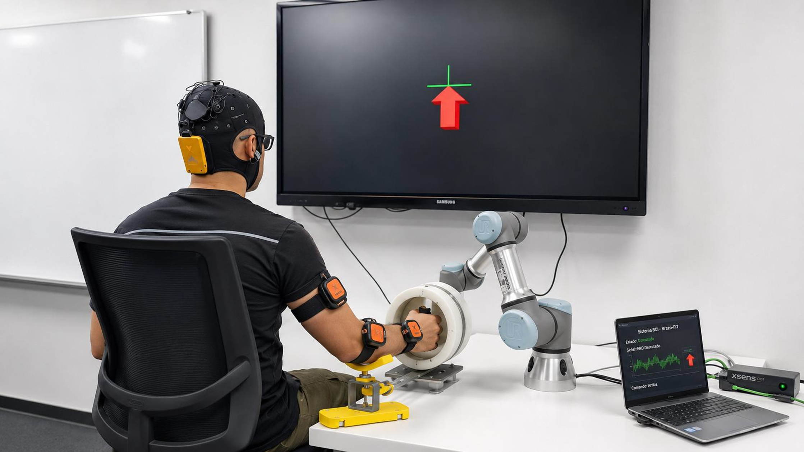
</div>

```mermaid
flowchart LR
    U["Usuario<br/>intención motora"] --> E["EEG Enobio 8<br/>500 Hz · 8 canales"]
    E --> N["NIC2<br/>reloj maestro"]
    N --> L["LSL<br/>local_clock()"]
    L --> P["Python<br/>protocolo + hilos"]
    P -- "robot_extend / robot_return" --> R["Robot UR3<br/>RTDE · moveL"]
    R --> F["Retroalimentación<br/>movimiento asistido"]
    F -. "cierra el lazo" .-> U
    P --> C[("CSV<br/>data/raw/*.csv")]
    C -. "offline" .-> A["Pipeline EEG<br/>filtrado + QC granular"]
    A --> D["ERD / ERS"]
    D --> X["Características"]
    X --> K["Clasificador<br/>LDA · SVM · EEGNet"]
    K --> M["Resultados<br/>métricas"]

    style U fill:#e8f4fd,stroke:#2b6cb0
    style E fill:#e8f4fd,stroke:#2b6cb0
    style N fill:#e8f4fd,stroke:#2b6cb0
    style L fill:#e8f4fd,stroke:#2b6cb0
    style P fill:#e8f4fd,stroke:#2b6cb0
    style R fill:#e8f4fd,stroke:#2b6cb0
    style F fill:#e8f4fd,stroke:#2b6cb0
    style C fill:#e8f4fd,stroke:#2b6cb0
    style A fill:#fdf0e3,stroke:#b9611a
    style D fill:#fdf0e3,stroke:#b9611a
    style X fill:#fdf0e3,stroke:#b9611a
    style K fill:#fdf0e3,stroke:#b9611a
    style M fill:#fdf0e3,stroke:#b9611a
```

**Azul:** flujo en tiempo real (durante la sesión) · **Naranja:** flujo *offline* (posterior a la sesión)

### Flujo de datos y módulos

| Paso | Etapa | Entrada → salida | Módulo |
|:---:|---|---|---|
| 1 | Adquisición con protocolo | Stream LSL del Enobio → CSV crudo en µV con eventos | `main.py`, `src/acquisition`, `src/protocol` |
| 2 | Retroalimentación robótica | `robot_extend` / `robot_return` → movimiento del UR3 | `src/robot/ur3_controller.py` |
| 3 | Filtrado | `data/raw` → `data/filtered` | `filter_eeg.py` |
| 4 | Control de calidad | `data/filtered` → `data/dataset` (índice, calidad, máscara, baseline) | `preparar_dataset.py` |
| 5 | Análisis ERD/ERS | `data/dataset` → `data/analysis` | `erd_ers_trials.py` |
| 6 | Épocas y características | Señal filtrada + máscara → `epochs.npz` y tablas | `extract_epochs.py`, `extract_features.py` |
| 7 | Clasificación offline | `epochs.npz` → métricas por fold | `fbcsp_lda.py` |
| 8 | Modelo final | Todos los ensayos del sujeto → archivo `.joblib` | `train_final_model.py` |
| 9 | Validación online | Bloques en vivo → decisión y movimiento del robot | `main_online.py`, `online_session.py` |
| 10 | Replay y LORO | Corridas grabadas → métricas y prueba binomial | `replay_online.py`, `run_loro.py` |

---

## Hardware y montaje

| Componente | Detalle |
|---|---|
| **Casco EEG** | Enobio 8 (Neuroelectrics), 500 Hz, transmisión por LSL en µV |
| **Canales activos** | **F3, T7, C3, Cz, P3** (sistema 10-20) — canales 6 a 8 sin conectar |
| **Robot** | Universal Robots **UR3**, control por **RTDE** sobre Ethernet directa (IP estática `192.168.0.1`, *Remote Control* habilitado) |
| **Efector final** | Mecanismo brazo-fit acoplado al UR3 |
| **Software** | NIC2 · `pylsl` · `ur-rtde` · `pygame` · Python |

<div align="center">

| Casco Enobio 8 | Ubicación de electrodos (10-20) |
|:---:|:---:|
| 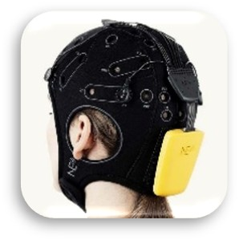 | 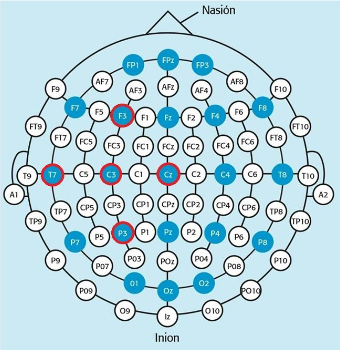 |

| Robot UR3 | Acople brazo-fit |
|:---:|:---:|
| 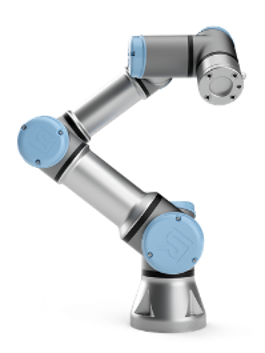 | 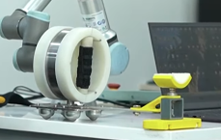 |

</div>

---

## Protocolo experimental Graz

El protocolo adapta el paradigma de **Graz** [\[6\]](#referencias), [\[7\]](#referencias). Cada ensayo se divide en fases cronometradas con un reloj de alta resolución; la interfaz (`pygame`) muestra el estímulo y emite un tono a los 2 s del reposo. Al entrar en `MOTION` y `RESET` se activan dos señales booleanas, `robot_extend` y `robot_return`, que comandan al UR3 **en el mismo instante** en que cambia el estímulo.

<div align="center">
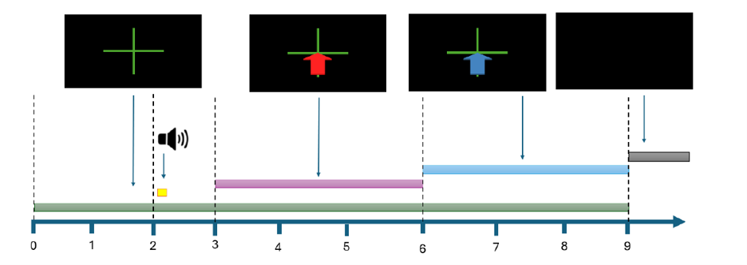
</div>

| Tiempo (s) | Fase | Evento | Estímulo y acción |
|:---:|:---:|:---:|---|
| 0 – 3 | **CROSS** | 100 | Cruz de fijación (**reposo**). Tono en t = 2 s. |
| 3 – 6 | **INTENTION** | 200 | Flecha roja: el participante **intenta** el movimiento de empuje del brazo derecho. |
| 6 – 9 | **MOTION** | 300 | Flecha azul: el **robot extiende** el brazo. |
| 9 + Δ | **RESET** | 400 | Pantalla negra: el robot regresa a **HOME**. Δ aleatorio entre 1,5 y 3,0 s. |

- Cada **corrida = 10 ensayos**.
- El diseño exige **≥ 40 ensayos por clase y por participante** → **4 corridas** por participante (R1 a R4).
-  Se instruye al participante: **intentar, no imaginar**, el empuje del brazo derecho cuando aparece la flecha roja.

---

## Adquisición y sincronización

Un **hilo dedicado** lee el flujo LSL y encola las muestras, mientras el bucle principal actualiza el protocolo, la interfaz y el robot. Cada sesión genera un CSV con las columnas:

```
datetime, timestamp, event_id, event_label, trial, F3, T7, C3, Cz, P3
```

<details>
<summary><b>Problema resuelto: marcas de tiempo negativas en el CSV</b></summary>

Aparecían muestras con tiempo negativo porque algunas entraban al *buffer* entre el vaciado del *backlog* y la fijación del tiempo cero. Vaciar el buffer antes no lo elimina del todo, porque `lib_lsl` sigue recibiendo datos.

**Solución:** calcular el tiempo relativo **dentro del propio hilo de lectura**, en el momento en que la muestra sale del *inlet*, y descartar las negativas. Así ninguna fila del archivo puede tener tiempo negativo, sin importar el orden de inicialización.

</details>

---

## Preprocesamiento y control de calidad

| Parámetro | Valor | Función |
|---|---|---|
| Notch | 60 Hz y armónicos hasta Nyquist | Interferencia de la red eléctrica |
| Pasa-banda | **FIR de fase cero, 6 a 47 Hz** | Banda de interés motor |
| Relleno de bordes | Reflexión de 500 muestras | Absorber el transitorio del FIR |
| `ARTIFACT_PTP_UV` | **120 µV** | Umbral pico a pico por sub-ventana |
| `WINDOW_SEC` | 0,5 s (250 muestras) | Tamaño de la sub-ventana |
| `MIN_CLEAN_FRACTION` | 0,6 | Fracción mínima de muestras limpias |

**Control de calidad granular.** En lugar de descartar el ensayo completo, se evalúan **sub-ventanas de 0,5 s por canal y por fase**; solo las que superan 120 µV pico a pico se excluyen. Un conjunto *(canal, fase, ensayo)* se conserva si queda ≥ 60 % de muestras limpias.

> Ejemplo que motivó el diseño: un pico de movimiento de ~0,5 s en T7 durante CROSS. Antes se perdía el ensayo entero; ahora se pierde solo esa ventana y los otros cuatro canales no se tocan.

**Salidas:** `index.csv`, `calidad_canal_fase.csv`, una máscara booleana muestra a muestra por archivo y `baseline.csv` (calculado solo con muestras limpias de CROSS).

<div align="center">

| Señal cruda | Señal filtrada |
|:---:|:---:|
| 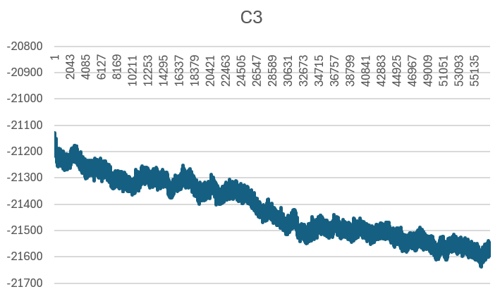 | 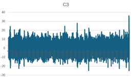 |

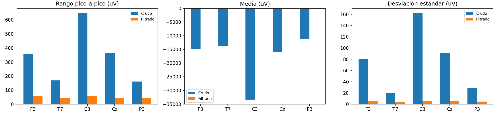

</div>

---

## Análisis ERD/ERS

**La huella del movimiento.** En reposo, las neuronas motoras oscilan juntas (ritmos **mu** y **beta**). Al **intentar mover**, esa potencia **cae**: eso es la **ERD** (desincronización relacionada con eventos). El aumento posterior es la **ERS**. Ambas se cuantifican como el **cambio porcentual de potencia respecto a la línea base** (muestras limpias de CROSS).

`erd_ers_trials.py` calcula el ERD/ERS en **cuatro niveles jerárquicos**: por ensayo → por corrida → por persona → global, con reprocesamiento incremental (solo recalcula carpetas incompletas).

Tres rutas complementarias:

| Ruta | Para qué |
|---|---|
| **Envolvente de Hilbert** | Potencia instantánea por banda |
| **Wavelets de Morlet** | Espectrograma relacionado con eventos (ERSP) con corrección **FDR de Benjamini-Hochberg** [\[8\]](#referencias) |
| **Densidad espectral de Welch** | Comparar línea base vs. tarea [\[9\]](#referencias) |

Un ensayo solo se incluye si tiene las tres fases (CROSS, INTENTION, MOTION). Las estadísticas se reportan en modo **GLOBAL** (por sujeto/archivo, evitando pseudo-réplica) e **INDIVIDUAL** (por ensayo). Cada carpeta de salida contiene un reporte CSV y siete gráficas.

<div align="center">
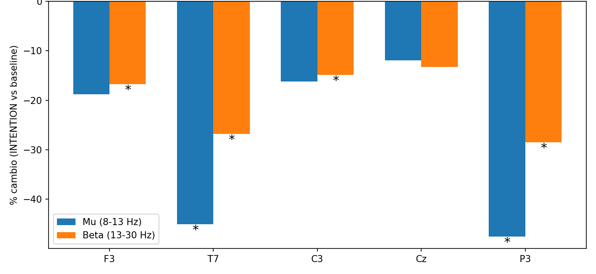
</div>

---

## Características y modelos

La tarea es **binaria**: `CROSS` (clase 0, reposo) vs. `INTENTION` (clase 1, intento).
Ventanas de análisis: **primeros 2 s de CROSS** y **0,5 – 3,0 s de INTENTION**.

### Las tres familias de modelos

| Modelo | Familia | Entrada | Estado |
|---|---|---|---|
| **LDA** | Lineal clásico | Características (potencia por bandas, Laplaciano, **FBCSP**) | Implementado (FBCSP + LDA) |
| **SVM** | Método de margen | Características espectrales | En desarrollo |
| **EEGNet** | Red neuronal ligera | Series temporales multicanal | En desarrollo |

Todos son **sujeto-específicos** y se evalúan con **las mismas particiones**, para que las diferencias se atribuyan al modelo y no a los datos. No se incluyen clasificadores de geometría Riemanniana ni arquitecturas híbridas profundas (CNN-LSTM, atención) porque exceden el criterio de comparabilidad para un sistema en tiempo real.

### Métodos de extracción de características

| Método | Características | Dim. | Modelo |
|---|---|:---:|---|
| Potencia por bandas (5 canales) | mu (8–13 Hz), beta baja (13–20 Hz), beta alta (20–30 Hz) por canal, con Welch | 15 | LDA y SVM |
| Laplaciano en C3 | C3 menos el promedio de sus vecinos (F3, T7, Cz, P3) + potencia por bandas e intervalos [\[10\]](#referencias) | 23 | LDA y SVM |
| 5 canales con bandas e intervalos | PSD de Welch por bandas e intervalos en cada canal | 115 | LDA y SVM |
| **FBCSP** | Log-varianza tras filtros CSP en 6 sub-bandas de 4 Hz (8–32 Hz), 2 pares por banda | 24 candidatas → **8** seleccionadas | LDA |
| Señal filtrada | Series temporales segmentadas; la red aprende sus filtros | — | EEGNet |

### Cadena FBCSP + LDA (implementada)

> Todo lo que se aprende de los datos se ajusta **solo con el fold de entrenamiento** (sin fuga de información).

1. Filtrado en **6 sub-bandas** Butterworth de orden 4 y fase cero: 8–12, 12–16, 16–20, 20–24, 24–28 y 28–32 Hz.
2. **Covarianza espacial** por época (solo muestras limpias, normalizada por la traza).
3. **CSP** (autovalores generalizados CROSS vs. INTENTION) con *shrinkage* 0,1 → 2 pares de filtros por banda [\[11\]](#referencias), [\[12\]](#referencias).
4. **Log-varianza** de la señal proyectada.
5. Selección de **8 características** por información mutua (`SelectKBest`) + estandarización.
6. **LDA** (solver `lsqr`, *shrinkage* automático).

**Validación:** `GroupKFold` de 5 particiones agrupadas por ensayo (los ensayos del mismo `archivo|trial` nunca se reparten entre entrenamiento y prueba) y **LORO** (*leave-one-run-out*).

---

## Métricas: más allá de la exactitud

<div align="center">

| Exactitud | TPR | Latencia | Tiempo de inferencia | Velocidad de cómputo |
|:---:|:---:|:---:|:---:|:---:|

</div>

| Métrica | Definición | Cómo se mide |
|---|---|---|
| **Exactitud** | Clasificaciones correctas / total de ensayos | Por fold y por participante (+ exactitud balanceada y especificidad de CROSS) |
| **TPR** (sensibilidad) | VP / (VP + FN) sobre ensayos de INTENTION | Por fold y participante, desde la matriz de confusión |
| **Latencia** | Tiempo entre el inicio del evento de interés y la emisión del comando al robot | *Wall-clock* con marcas de tiempo de alta resolución de LSL |
| **Tiempo de inferencia** | Cómputo del modelo para predecir sobre una ventana ya preprocesada | En el equipo de evaluación, sin filtrado, E/S ni comunicación |
| **Velocidad de cómputo** | Memoria, operaciones y complejidad del modelo | Medidas en el mismo equipo |
| *Complementarias* | F1, matriz de confusión, curva ROC y AUC | Por participante y agregadas |

**Rigor estadístico.** Con pocos ensayos, superar el 50 % **no** basta como evidencia de aprendizaje, porque el umbral de significancia depende del número de ensayos [\[30\]](#referencias). Por eso los resultados se contrastan con una **prueba binomial frente al azar (p = 0,5)**, y la comparación final usará pruebas no paramétricas.

---

## Validación en línea con el UR3

La **misma clase `FilterBankCSP`** se usa para entrenar y para inferir: el modelo en vivo es exactamente el modelo entrenado. La lógica de decisión (`online_session.py`) no depende de hardware y puede probarse sin casco ni robot.

En cada ensayo:

1. Al terminar **CROSS** se clasifica el bloque **solo como registro** (verdad de terreno: clase 0). Sin esto no habría clase negativa y no se podría medir la especificidad.
2. Al terminar **INTENTION** se clasifica el bloque (3 s completos, con filtrado de fase cero sobre la ventana recortada, igual que en el entrenamiento).
3. La decisión gobierna al robot según el modo de la sesión.

| Modo | Comportamiento |
|---|---|
| **`shadow`** | El decodificador corre y **registra**, pero el robot **se mueve siempre**. |
| **`closed`** | El robot **solo se mueve si la decisión es INTENTION** (lazo cerrado real). |

**Verificación sin hardware:**
- `replay_online.py` reproduce una sesión grabada por el mismo camino de código y compara la probabilidad en línea contra una referencia causal y una de fase cero independiente (deben coincidir).
- `run_loro.py` implementa **LORO**: para cada corrida *k* entrena con las demás, evalúa en la *k* (que el modelo no vio) y agrupa resultados con prueba binomial.

### Seguridad del robot

- Movimiento **`moveL`**: el TCP sigue una línea recta cartesiana entre **HOME** y **EXTENDIDA**, a 0,79 m/s y 0,75 m/s², dentro de la ventana de 3 s de MOTION.
- Poses registradas con `calibrate_ur3.py` (ángulos de juntas y pose del TCP).
- La desconexión llama primero a `stopL` y `stopJ` para interrumpir cualquier movimiento bloqueante antes de cerrar RTDE: **no quedan comandos huérfanos**. El retorno a HOME también puede interrumpir una extensión en curso.

---

## BCI Hub

Interfaz web local (`interfaces/bci_hub`) para operar el pipeline por participante: lista de participantes, indicadores de avance, consola de ejecución y visor de gráficas. Con `scoped_run.py` se ejecuta **un solo paso** del pipeline para **un participante** sin sobrescribir los datos de los demás ni modificar los scripts originales.

<div align="center">
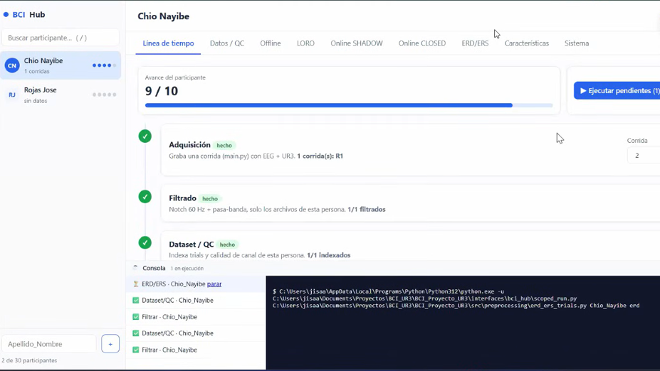
</div>

---

## Estructura del código

```
Proyecto_Corto/
├── main.py                    # Experimento de entrenamiento BCI + UR3 sincronizado
├── main_online.py             # Sesión de validación online
├── online_session.py          # Lógica de decisión (sin hardware)
├── replay_online.py           # Reproducción de sesiones grabadas
├── run_loro.py                # Validación leave-one-run-out
├── requirements.txt
├── config/
│   └── config.py              # Fs, canales, eventos, tiempos, nº de ensayos
├── src/
│   ├── acquisition/           # Conexión al stream LSL y registro en CSV
│   ├── protocol/              # Máquina de estados del protocolo e interfaz visual
│   ├── robot/                 # Controlador del UR3 y calibración de posiciones
│   ├── preprocessing/         # Filtrado, control de calidad y ERD/ERS
│   └── features/              # Extracción de épocas y de características
├── models/
│   └── fbcsp_lda/             # Núcleo FBCSP, evaluación, modelo final, inferencia online
├── interfaces/
│   └── bci_hub/               # Interfaz web y ejecución acotada por participante
└── data/
    ├── raw/                   # CSV crudos (µV + eventos)
    ├── filtered/              # Señal filtrada
    ├── dataset/               # Índice, calidad, máscara, baseline
    └── analysis/              # Reportes y gráficas ERD/ERS
```

---

## Cómo reproducir el flujo

### 1 · Preparación

```bash
pip install -r requirements.txt
```

1. Abrir **NIC2** con el stream LSL activo y verificar los **cinco canales**.
2. Conectar por Ethernet el PC y el UR3 en la misma subred, activar **Remote Control** y calibrar **HOME** y **EXTENDIDA** con `calibrate_ur3.py`.
3. Probar el robot sin EEG con los tiempos del protocolo.

### 2 · Sesión de adquisición

1. Ejecutar `main.py` e ingresar el nombre del participante y el número de corrida.
2. Colocar el casco, revisar impedancias y explicar la tarea (**intentar, no imaginar**).
3. Correr los 10 ensayos. El CSV crudo queda en `data/raw`. Repetir hasta **4 corridas** (≥ 40 ensayos por clase).

### 3 · Procesamiento y análisis

```bash
python src/preprocessing/filter_eeg.py
python src/preprocessing/preparar_dataset.py
python src/preprocessing/erd_ers_trials.py
python src/features/extract_epochs.py --filtered-dir data/filtered \
       --mask-dir data/dataset/qc_mask --out-dir features/epochs/<Sujeto>
python models/fbcsp_lda/fbcsp_lda.py --dirs features/epochs/<Sujeto>
python models/fbcsp_lda/train_final_model.py --epochs-dir features/epochs/<Sujeto>
```

### 4 · Validación en línea y LORO

```bash
# Modo: BCI_ONLINE_MODE=shadow|closed · BCI_MODEL=<modelo.joblib> · BCI_PREFILTER=6,47
python main_online.py

python replay_online.py --model <modelo.joblib> --raw-csv data/raw/<corrida>.csv --prefilter 6,47

python run_loro.py --key <Apellido> --subject-dir <Sujeto> --runs 1 2 3 4 --prefilter 6,47
```

### Parámetros principales

| Parámetro | Valor |
|---|---|
| Frecuencia de muestreo | 500 Hz |
| Canales | F3, T7, C3, Cz, P3 (índices LSL 1 a 5) |
| Ensayos por corrida | 10 |
| Fases | CROSS 3 s (tono a los 2 s) · INTENTION 3 s · MOTION 3 s · RESET + pausa 1,5–3,0 s |
| Códigos de evento | CROSS 100 · INTENTION 200 · MOTION 300 · RESET 400 · residual 999 |
| Filtro | Notch 60 Hz y armónicos; FIR fase cero 6–47 Hz |
| Control de calidad | 120 µV p-p · ventana 0,5 s · mínimo 60 % limpio |
| FBCSP | 6 bandas de 4 Hz (8–32 Hz) · 2 pares de filtros · shrinkage 0,1 · k = 8 |
| Validación | `GroupKFold` de 5 por ensayo · LORO por corrida · binomial contra 0,5 |
| UR3 | RTDE · `moveL` a 0,79 m/s y 0,75 m/s² · IP `192.168.0.1` |

---

## Estado del proyecto y hoja de ruta

> Estado a **21 de octubre de 2026** (semana 12 de 16 del primer semestre). Sin retraso frente al cronograma. **Este repositorio todavía no reporta cifras de desempeño**: se publicarán cuando se ejecute la evaluación final con la muestra completa.

### Por objetivo

| Ref. | Resultado esperado | Estado |
|:---:|---|---|
| **OE1** | Protocolo Graz y adquisición EEG sincronizada | Implementado |
| **OE2** | Pipeline de preprocesamiento, calidad y ERD/ERS | Implementado · falta correrlo con la muestra completa |
| **OE3** | Base de datos EEG de participantes sanos | En curso (adquisición de corridas en marcha) |
| **OE4** | Comparación de modelos con cinco métricas y validación robótica | Parcial: FBCSP+LDA y sesión online listos; faltan SVM, EEGNet y las métricas de latencia, tiempo de inferencia y velocidad de cómputo |

### Por fase de Design Science Research

| Fase | Estado |
|---|---|
| 1. Identificación del problema | Completada |
| 2. Objetivos de la solución | Completada |
| 3. Diseño y desarrollo | En curso avanzado (FBCSP+LDA implementado; SVM y EEGNet pendientes) |
| 4. Demostración | En curso (sesión en línea implementada; falta el conjunto completo de pruebas) |
| 5. Evaluación | Pendiente (validación cruzada y LORO listas para FBCSP+LDA) |
| 6. Comunicación | Pendiente |

### Pendiente
- [ ] Completar reclutamiento y adquisición de todas las corridas (N = 30)
- [ ] Ejecutar filtrado, calidad y ERD/ERS sobre toda la muestra
- [ ] Cerrar la evaluación de FBCSP+LDA (validación cruzada y LORO) para todos
- [ ] Implementar y entrenar **SVM** y **EEGNet** con los mismos datos y particiones
- [ ] Implementar la medición de latencia, TPR, tiempo de inferencia y velocidad de cómputo para los tres modelos
- [ ] Sesiones de validación en línea con el UR3 en modos `shadow` y `closed`
- [ ] Análisis estadístico no paramétrico, F1, ROC/AUC y selección del modelo
- [ ] Documento final y sustentación (fin del proyecto: **31 de mayo de 2027**)

---

## Referencias

1. F. Lotte *et al.*, "A review of classification algorithms for EEG-based brain-computer interfaces: A 10 year update," *J. Neural Eng.*, vol. 15, no. 3, 2018. doi: [10.1088/1741-2552/aab2f2](https://doi.org/10.1088/1741-2552/aab2f2)
2. P. Arpaia *et al.*, "How to successfully classify EEG in motor imagery BCI: A metrological analysis of the state of the art," *J. Neural Eng.*, vol. 19, no. 3, 2022. doi: [10.1088/1741-2552/ac74e0](https://doi.org/10.1088/1741-2552/ac74e0)
3. S. Chen *et al.*, "The differences between motor attempt and motor imagery in brain-computer interface accuracy and event-related desynchronization of patients with hemiplegia," *Front. Neurorobot.*, vol. 15, 2021. doi: [10.3389/fnbot.2021.706630](https://doi.org/10.3389/fnbot.2021.706630)
4. K. Peffers *et al.*, "A design science research methodology for information systems research," *J. Manag. Inf. Syst.*, vol. 24, no. 3, pp. 45–77, 2007. doi: [10.2753/MIS0742-1222240302](https://doi.org/10.2753/MIS0742-1222240302)
5. Verein Deutscher Ingenieure, *VDI 2206: Design Methodology for Mechatronic Systems*. Berlin: Beuth Verlag, 2004.
6. G. Pfurtscheller and C. Neuper, "Motor imagery and direct brain-computer communication," *Proc. IEEE*, vol. 89, no. 7, pp. 1123–1134, 2001. doi: [10.1109/5.939829](https://doi.org/10.1109/5.939829)
7. J. R. Wolpaw and E. W. Wolpaw, Eds., *Brain-Computer Interfaces: Principles and Practice*. Oxford Univ. Press, 2012.
8. Y. Benjamini and Y. Hochberg, "Controlling the false discovery rate," *J. R. Stat. Soc. Ser. B*, vol. 57, no. 1, pp. 289–300, 1995. doi: [10.1111/j.2517-6161.1995.tb02031.x](https://doi.org/10.1111/j.2517-6161.1995.tb02031.x)
9. P. D. Welch, "The use of fast Fourier transform for the estimation of power spectra," *IEEE Trans. Audio Electroacoust.*, vol. 15, no. 2, pp. 70–73, 1967. doi: [10.1109/TAU.1967.1161901](https://doi.org/10.1109/TAU.1967.1161901)
10. D. J. McFarland *et al.*, "Spatial filter selection for EEG-based communication," *Electroencephalogr. Clin. Neurophysiol.*, vol. 103, no. 3, pp. 386–394, 1997. doi: [10.1016/S0013-4694(97)00022-2](https://doi.org/10.1016/S0013-4694(97)00022-2)
11. K. K. Ang *et al.*, "Filter bank common spatial pattern (FBCSP) in brain-computer interface," *IJCNN*, 2008, pp. 2390–2397. doi: [10.1109/IJCNN.2008.4634130](https://doi.org/10.1109/IJCNN.2008.4634130)
12. B. Blankertz *et al.*, "Optimizing spatial filters for robust EEG single-trial analysis," *IEEE Signal Process. Mag.*, vol. 25, no. 1, pp. 41–56, 2008. doi: [10.1109/MSP.2008.4408441](https://doi.org/10.1109/MSP.2008.4408441)
13. Z. Huang and M. Wang, "A review of electroencephalogram signal processing methods for brain-controlled robots," *Cogn. Robot.*, vol. 1, 2021. doi: [10.1016/j.cogr.2021.07.001](https://doi.org/10.1016/j.cogr.2021.07.001)
14. A. S. Angulo Medina *et al.*, "Electroencephalography-based brain-computer interfaces in rehabilitation: A bibliometric analysis (2013–2023)," *Sensors*, vol. 24, no. 22, 2024. doi: [10.3390/s24227125](https://doi.org/10.3390/s24227125)
15. K. K. Ang *et al.*, "A randomized controlled trial of EEG-based motor imagery brain-computer interface robotic rehabilitation for stroke," *Clin. EEG Neurosci.*, vol. 46, no. 4, pp. 310–320, 2015. doi: [10.1177/1550059414522229](https://doi.org/10.1177/1550059414522229)
16. J. He *et al.*, "Multimodal assessment of a BCI system for stroke rehabilitation integrating motor imagery and motor attempts: a randomized controlled trial," *J. Neuroeng. Rehabil.*, vol. 22, no. 1, 2025. doi: [10.1186/s12984-025-01723-8](https://doi.org/10.1186/s12984-025-01723-8)
17. I. Rakhmatulin and G. R. Naik, *EEG Signal Processing with Python*. Springer Nature Singapore, 2026. doi: [10.1007/978-981-95-4177-5](https://doi.org/10.1007/978-981-95-4177-5)
18. G. Pfurtscheller and F. H. Lopes da Silva, "Event-related EEG/MEG synchronization and desynchronization: Basic principles," *Clin. Neurophysiol.*, vol. 110, no. 11, pp. 1842–1857, 1999. doi: [10.1016/S1388-2457(99)00141-8](https://doi.org/10.1016/S1388-2457(99)00141-8)
19. H. W. Ng *et al.*, "CASTNet: Cycle-consistent attention-based network for decoding open/close hand movement attempts using EEG," *IJCNN*, 2024. doi: [10.1109/IJCNN60899.2024.10651226](https://doi.org/10.1109/IJCNN60899.2024.10651226)
20. K. Shrestha *et al.*, "Attempted movement classification of spinal cord injured patients using hybrid CNN-LSTM networks," *Int. J. Imaging Syst. Technol.*, vol. 34, no. 3, 2024. doi: [10.1002/ima.23104](https://doi.org/10.1002/ima.23104)
21. W. H. Elashmawi *et al.*, "A comprehensive review on brain–computer interface (BCI)-based machine and deep learning algorithms for stroke rehabilitation," *Appl. Sci.*, vol. 14, no. 14, 2024. doi: [10.3390/app14146347](https://doi.org/10.3390/app14146347)
22. I. Korkmaz and C. Tepe, "EEG-based motor execution classification of upper and lower extremities using machine learning," *Comput. Methods Biomech. Biomed. Engin.*, 2025. doi: [10.1080/10255842.2025.2566260](https://doi.org/10.1080/10255842.2025.2566260)
23. A. Tuvshinjargal and E. Kim, "ML vs DL: Accuracy and testing runtime trade-offs in BCI," *LNCS*, vol. 13519, 2022. doi: [10.1007/978-3-031-17618-0_35](https://doi.org/10.1007/978-3-031-17618-0_35)
24. M. Taghavi and M. Shoaran, "Hardware complexity analysis of deep neural networks and decision tree ensembles for real-time neural data classification," *NER*, 2019, pp. 407–410. doi: [10.1109/NER.2019.8716983](https://doi.org/10.1109/NER.2019.8716983)
25. V. J. Lawhern *et al.*, "EEGNet: A compact convolutional neural network for EEG-based brain-computer interfaces," *J. Neural Eng.*, vol. 15, no. 5, 056013, 2018. doi: [10.1088/1741-2552/aace8c](https://doi.org/10.1088/1741-2552/aace8c)
26. W. Ma *et al.*, "A lightweight and accurate double-branch neural network for four-class motor imagery classification," *Biomed. Signal Process. Control*, vol. 75, 2022. doi: [10.1016/j.bspc.2022.103582](https://doi.org/10.1016/j.bspc.2022.103582)
27. Q. Li *et al.*, "Hands-free mobility control: A low-latency asynchronous MI-BCI system for real-time robotic navigation with cognitive-ergonomic enhancement," *IEEE Trans. Hum.-Mach. Syst.*, vol. 56, no. 2, pp. 291–300, 2026. doi: [10.1109/THMS.2026.3659708](https://doi.org/10.1109/THMS.2026.3659708)
28. Z. Shuqfa *et al.*, "Decoding multi-class motor imagery and motor execution tasks using Riemannian geometry algorithms on large EEG datasets," *Sensors*, vol. 23, no. 11, 2023. doi: [10.3390/s23115051](https://doi.org/10.3390/s23115051)
29. M. Heim *et al.*, "Real-time EEG-based BCI for self-paced motor imagery and motor execution using functional neural networks," *IEEE Access*, vol. 13, pp. 91232–91247, 2025. doi: [10.1109/ACCESS.2025.3569932](https://doi.org/10.1109/ACCESS.2025.3569932)
30. E. Combrisson and K. Jerbi, "Exceeding chance level by chance: The caveat of theoretical chance levels in brain signal classification and statistical assessment of decoding accuracy," *J. Neurosci. Methods*, vol. 250, pp. 126–136, 2015. doi: [10.1016/j.jneumeth.2015.01.010](https://doi.org/10.1016/j.jneumeth.2015.01.010)
31. I. Carrara and T. Papadopoulo, "Pseudo-online framework for BCI evaluation: A MOABB perspective using various MI and SSVEP datasets," *J. Neural Eng.*, vol. 21, no. 1, 2024. doi: [10.1088/1741-2552/ad171a](https://doi.org/10.1088/1741-2552/ad171a)
32. J. Cantillo-Negrete *et al.*, "Brain-computer interface coupled to a robotic hand orthosis for stroke patients' neurorehabilitation: A crossover feasibility study," *Front. Hum. Neurosci.*, vol. 15, 2021. doi: [10.3389/fnhum.2021.656975](https://doi.org/10.3389/fnhum.2021.656975)
33. R. I. Carino-Escobar *et al.*, "Continuous versus discrete robotic feedback for brain-computer interfaces aimed for neurorehabilitation," *Front. Neurorobot.*, vol. 17, 2023. doi: [10.3389/fnbot.2023.1015464](https://doi.org/10.3389/fnbot.2023.1015464)

---

## Glosario

| Término | Definición |
|---|---|
| **BCI** | Interfaz cerebro-computadora |
| **EEG** | Electroencefalografía |
| **ACV** | Accidente cerebrovascular |
| **Intención motora (MA)** | Intento real de ejecutar un movimiento, aunque no pueda completarse |
| **ERD / ERS** | Desincronización / sincronización relacionada con eventos: caída y posterior aumento de potencia en mu y beta |
| **CSP / FBCSP** | Patrones espaciales comunes y su versión con banco de filtros por sub-banda |
| **LDA / SVM / EEGNet** | Análisis discriminante lineal, máquina de soporte vectorial y red convolucional compacta para EEG |
| **LSL** | Lab Streaming Layer, transporte sincronizado de señales |
| **RTDE** | Real-Time Data Exchange, protocolo de Universal Robots |
| **LORO** | *Leave-one-run-out*: se entrena con todas las corridas menos una y se evalúa en la omitida |
| **TPR** | Tasa de verdaderos positivos (sensibilidad) |
| **TCP** | Punto central de la herramienta del robot |

---

## Autores y contacto

| Rol | Nombre |
|---|---|
| **Autor** | Julio Isaac Guzmán Montoya — [jguzman228@unab.edu.co](mailto:jguzman228@unab.edu.co) |
| **Director** | Johann Barragán Gómez |
| **Codirectora** | Nayibe Chio Cho |
| **Línea de investigación** | Robótica y Sistemas Mecatrónicos aplicados a la Rehabilitación |
| **Institución** | Universidad Autónoma de Bucaramanga (UNAB) · Facultad de Ingeniería |

<div align="center">

*Proyecto presentado en la **Semana de la Ingeniería 2026***

</div>
